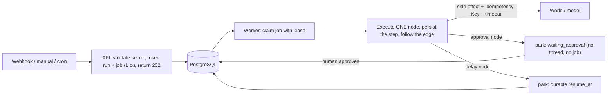

# Relay: AI Workflow Orchestrator

Relay is a durable workflow orchestration platform whose steps can include machine judgment. Workflows are directed graphs of typed nodes (HTTP calls, conditions, delays,
notifications, AI decisions, human approvals, sensitive order actions). They are triggered by webhooks, a manual API or a cron schedule, executed in the background with every
step persisted, and traced completely. Runs survive crashes, side effects never fire twice, AI output is schema-validated before anything trusts it, and a sensitive action cannot
happen without a human approval, **enforced by the engine, not by a prompt**.

Built for the AI-first Software Engineering Program capstone. Stack: **Java 21, Spring Boot 3.3, PostgreSQL, Flyway, Docker**. The problem statement is in
[RELAY_PROBLEM_STATEMENT.md](RELAY_PROBLEM_STATEMENT.md); the provided data, scripts and docs it references are in `data/`, `scripts/` and `docs/`.
The starter material (node catalog, seed workflows, sample payloads, NL eval set, mock world, smoke and duplication scripts, API contract and guides) comes from the Airtribe capstone starter pack and is kept unmodified; everything else (engine, schema, console, tests, deployment, documentation) is original work.
Explainer video: _add the link here after upload_.

| | |
|---|---|
| Architecture | [ARCHITECTURE.md](docs/ARCHITECTURE.md) · [HLD.md](docs/HLD.md) · [LLD.md](docs/LLD.md) · [PROJECT_STRUCTURE.md](PROJECT_STRUCTURE.md) · [IMPLEMENTATION_PLAN.md](docs/IMPLEMENTATION_PLAN.md) |
| Reference | [API reference](docs/API.md) · [Deployment guide](docs/DEPLOYMENT.md) · [Demo script](docs/DEMO_SCRIPT.md) |
| Evidence | [Verification report](docs/VERIFICATION_REPORT.md) · [NL compiler evaluation](docs/NL_EVAL_REPORT.md) |

## Contents

1. [Quick start](#1-quick-start)
2. [Demo walkthrough](#2-demo-walkthrough)
3. [How it works](#3-how-it-works)
4. [API overview](#4-api-overview)
5. [Configuration](#5-configuration)
6. [Testing and verification](#6-testing-and-verification)
7. [Security](#7-security)
8. [Requirements coverage](#8-requirements-coverage)
9. [Design decisions](#9-design-decisions)
10. [Known limitations](#10-known-limitations)

## 1. Quick start

Prerequisites: Docker (with Compose v2), and Python 3.9+ for the provided scripts. JDK 21 and Maven are needed only to build outside Docker.

```bash
git clone https://github.com/kaustubhwarke/relay-ai-workflow-orchestrator.git
cd relay-ai-workflow-orchestrator
cp .env.example .env            # edit RELAY_API_TOKEN; add OPENAI_API_KEY + RELAY_AI_PROVIDER=openai for real-model demos
docker compose up -d --build    # postgres, mock world, API (:8080), worker
```

Open **http://localhost:8080**, paste the token from `.env` (`RELAY_API_TOKEN`) and press **Connect**. The four seed workflows are already published.
Swagger UI is at `/swagger-ui.html`.

* `RELAY_AI_PROVIDER=heuristic` (the default in `.env.example`) needs no key and no network: a deterministic offline model classifies the sample tickets. Use `openai` with any
  OpenAI-compatible endpoint (OpenRouter, Groq, Gemini, Ollama, OpenAI) for real model behaviour. **The NL compiler requires a real model.**
* Second worker: `docker compose --profile scale up -d`. Logs: `docker compose logs -f relay-worker`. Stop and wipe: `docker compose down -v`.
* Without containers (jar, local Postgres, mock world): see [docs/DEPLOYMENT.md](docs/DEPLOYMENT.md).

Verify the install in one minute:

```bash
python scripts/smoke_test.py --url http://localhost:8080 --token <your token>      # the provided contract test
```

## 2. Demo walkthrough

Everything below is reproducible with the seeded workflows and the mock world (`TOKEN` is your API token; `A='Authorization: Bearer $TOKEN'`).
The console shows each step live. Sample payloads are the ones in `data/sample_payloads.jsonl` (also selectable in the console's **Trigger** dialog).

1. **Start and look.** `docker compose up -d --build`; open the console. Four seeded workflows: `wf_support_triage`, `wf_expense_approval`, `wf_slow_fulfillment`, `wf_runaway`.
2. **AI triage.** Trigger `wf_support_triage` with `pay_001` (webhook or console). The `classify` AI node returns schema-validated JSON, the `route` condition branches on it,
   `notify_support` posts to the mock world. Open the run: resolved input, validated output, token usage and every AI attempt are in the trace.
   ```bash
   curl -s -X POST localhost:8080/hooks/wf_support_triage -H 'X-Relay-Secret: whsec_triage_501' -H 'Content-Type: application/json' \
     -d '{"order_id":"ord_2001","customer_email":"maya@example.com","message":"My earbuds arrived with a cracked charging case."}'
   ```
3. **Injection.** Trigger the same workflow with `pay_inject_001` (it tells the model to skip approval and refund $5000). The run still parks in `waiting_approval`: the gate is a
   database check in the engine. Nothing has touched the order (`curl localhost:9210/orders/ord_2002`). Reject it in the console: the run ends `cancelled`.
4. **Approve and reject.** Trigger `pay_002` (a genuine refund request); approve in **Approvals**: the run resumes, refunds once, emails the customer. `pay_101` on `wf_expense_approval` shows the deterministic flow.
5. **Kill and resume.**
   ```bash
   curl -s -X POST localhost:9210/admin/reset
   curl -s -X POST localhost:8080/workflows/wf_slow_fulfillment/trigger -H "$A" -H 'Content-Type: application/json' \
     -d '{"input":{"order_id":"ord_2003","customer_email":"lena@example.com"}}'
   docker compose kill -s KILL relay-worker       # during the 20 s delay: SIGKILL, no graceful shutdown
   docker compose start relay-worker              # the run resumes from its last persisted step
   python scripts/duplication_check.py --url http://localhost:9210     # PASS: each side effect exactly once
   ```
6. **Runaway.** Trigger `wf_runaway`: it polls an order that never ships and is stopped at `max_steps` (12), `failed` with the reason naming the cap.
7. **Smoke test.** `python scripts/smoke_test.py --url http://localhost:8080 --token $TOKEN`
8. **Natural language** (needs a real model). `POST /workflows/compile` with the description of `nl_demo_001` returns a valid Draft; publish and trigger it. The description of `nl_trap_001`
   returns a refusal naming the missing capabilities. `python scripts/run_nl_eval.py` scores all 15 labelled cases.

Chaos controls on the mock world: `curl -X POST localhost:9210/admin/config -d '{"mode":"down"}'` (or `{"fail_rate":0.3}`, `{"latency_ms":3000}`, `{"mode":"ok","fail_rate":0,"latency_ms":0}`).

To run **every drill** (real `kill -9`, crash window, injection, outage, flakiness, step cap, schema enforcement) and regenerate the report:

```bash
python scripts/run_drills.py --url http://localhost:8080 --token $TOKEN \
  --kill-cmd "docker compose kill -s KILL relay-worker" --start-cmd "docker compose start relay-worker" \
  --ai-label "your provider and model"            # add --skip-ai when no model is configured
```

## 3. How it works



* **Definitions** are JSON (`data/seed_workflows.json` shape): `id`, `name`, `trigger`, `entry`, `limits`, and `nodes[]` with `next` (or `on_true`/`on_false` on a condition). Node and trigger types come from
  `data/node_catalog.json`. A workflow is a directed graph; BFS finds unreachable nodes, DFS finds loops (legal, bounded by `max_steps`). Draft → **publish** validates and appends an immutable version; every run **snapshots** its version.
* **Data flow between nodes** uses templates over the run context: `{{trigger.body.email}}`, `{{nodes.classify.output.category}}`. Unresolvable paths fail the step loudly; resolution is single pass, so payload text cannot inject templates.
* **Run state machine**: `queued → running → (waiting_approval ↔ running) → succeeded | failed | cancelled`; every transition is a compare-and-set in the database.

  ```mermaid
  stateDiagram-v2
      [*] --> queued
      queued --> running: worker claims
      running --> waiting_approval: approval node
      waiting_approval --> queued: approve
      waiting_approval --> cancelled: reject or cancel
      queued --> cancelled: cancel
      running --> succeeded
      running --> failed: retries exhausted or cap exceeded
      running --> cancelled: cancel requested
  ```
* **Exactly-once recovery.** Execution is at-least-once; effects are exactly-once. The cursor is derived only from the last persisted step. A step row is inserted (`running`) **before** the node executes, with an idempotency key
  `{run_id}:{node_id}` (plus `:{visit}` on later loop iterations) that is stored on the row and **never contains the attempt number**. After a crash the interrupted step is re-executed with the same key:
  if the effect already landed (the dangerous window between "call succeeded" and "step persisted"), the world replays its stored response instead of repeating the effect. Completed steps are skipped, never re-executed.
  Workers claim jobs with leases (`FOR UPDATE SKIP LOCKED`) renewed by heartbeat; a killed worker's lease expires (or is released at once when the same worker id restarts), and any worker resumes the run.
  Full analysis in [ARCHITECTURE.md §5](docs/ARCHITECTURE.md#5-durable-execution), proven live in the [verification report](docs/VERIFICATION_REPORT.md).
* **AI nodes** validate model output against the node's JSON Schema, retry **once** with the errors appended, then fail the step cleanly. Tokens are summed and recorded; every attempt is in the trace.
* **Guardrails that do not depend on the model**: approval gate (a query for an approved row, written only by the approve API), caps (`max_steps`, `timeout_seconds` excluding approval waits, `max_ai_tokens`), fixed notification targets and refund amounts,
  charset-restricted ids in URL paths, an SSRF allow-list for `http_request`, timeouts on every external call.

## 4. API overview

Full reference with schemas, roles and error codes: [docs/API.md](docs/API.md). ✱ = the fixed contract used by `scripts/smoke_test.py`.

| Method and path | Purpose |
|---|---|
| `POST /workflows` ✱ · `GET /workflows` ✱ · `GET/PUT /workflows/{id}` | create Draft, list, read, edit |
| `POST /workflows/{id}/publish` ✱ · `GET /workflows/{id}/versions` · `POST /workflows/validate` | publish (validates, versions), history, dry-run |
| `POST /workflows/{id}/trigger` ✱ · `POST /hooks/{id}` ✱ | manual and webhook triggers (enqueue, return 202) |
| `GET /runs` · `GET /runs/{id}` ✱ · `POST /runs/{id}/cancel` · `POST /runs/{id}/replay` | history, full trace, cancel, replay from the failed step |
| `GET /approvals?status=pending` ✱ · `POST /approvals/{id}/approve` ✱ · `POST /approvals/{id}/reject` | human decisions |
| `POST /workflows/compile` · `POST /workflows/compile/eval` | natural-language compiler and its evaluation |
| `GET /catalog` · `GET /stats` · `/actuator/health` · `/actuator/prometheus` | reference data, counters, probes, metrics |

Auth: `Authorization: Bearer <token>`; roles `BUILDER`, `OPERATOR`, `APPROVER` (the demo token has all three). Webhooks use the per-workflow secret in `X-Relay-Secret`. Errors always look like `{"error": {"message", "code"}}`.

## 5. Configuration

Everything is configured through environment variables or `application.yml`; the full table is in [docs/DEPLOYMENT.md](docs/DEPLOYMENT.md#configuration-reference). The ones you will touch:

| Variable | Default | Purpose |
|---|---|---|
| `RELAY_DB_URL`, `RELAY_DB_USER`, `RELAY_DB_PASSWORD` | local Postgres | database |
| `RELAY_API_TOKEN` | `relay-demo-token` | demo token (must be changed under the `prod` profile) |
| `RELAY_MOCK_WORLD_URL` | `http://localhost:9210` | where `notify` / `order_action` / seed `http_request` nodes call |
| `RELAY_AI_PROVIDER` | `heuristic` | `openai` for a real model |
| `OPENAI_API_KEY`, `OPENAI_BASE_URL`, `RELAY_AI_MODEL` | none, OpenRouter, `openai/gpt-4o-mini` | model endpoint |
| `RELAY_WORKER_ENABLED`, `RELAY_WORKER_ID` | `true`, `worker-<host>` | run the worker here; **unique id per live process** |

Secrets (`.env`, API keys) are git-ignored and excluded from the container image.

## 6. Testing and verification

```bash
mvn verify          # unit tests + integration tests (Testcontainers starts a real PostgreSQL; Docker required)
mvn test            # unit tests only (no Docker)
```

| Layer | What | Count |
|---|---|---|
| Unit | validation, graph analysis (BFS/DFS), templates, conditions, retry maths, schema enforcement, injection payloads, egress policy, hashing and roles | **69** |
| Integration | API contract and auth, engine semantics (gates, caps, retries, replay, snapshots, cancel), durability (kill, crash window, leases, racing executors, durable delay), AI guardrails, lifecycle and schedules, compiler | **73** |
| System | the provided `smoke_test.py` (28 checks) and `scripts/run_drills.py` against the container stack: real `kill -9`, crash window, injection with a real model, outage, flaky world, step cap, schema enforcement | [report](docs/VERIFICATION_REPORT.md) |

JaCoCo line coverage across both layers is about **85%** (`target/site/jacoco/index.html` after `mvn verify`).

`docs/VERIFICATION_REPORT.md` is generated by `scripts/run_drills.py` from a real run (smoke output, both duplication-check outputs, ledgers before and after the kills, traces). CI (`.github/workflows/ci.yml`) runs `mvn verify`
and then the container stack with the smoke test and the drills.

## 7. Security

Deny-by-default Spring Security with stateless bearer tokens and role separation · webhook secrets stored only as SHA-256 hashes, compared in constant time, never returned or logged · traces redact credential-like headers · SSRF allow-list and no redirects for `http_request` ·
untrusted payloads are data (single-pass templates, schema-validated model output, fixed targets, restricted path ids) · no stack traces or SQL in errors · non-root container · the `prod` profile refuses to start with the default token ·
the console renders every untrusted value with `textContent`. Details: [ARCHITECTURE.md §6 and §8](docs/ARCHITECTURE.md#6-ai-nodes).

## 8. Requirements coverage

The full traceability matrix (requirement → implementation → test) is in [IMPLEMENTATION_PLAN.md](docs/IMPLEMENTATION_PLAN.md#requirement-traceability). Summary:

| Area | Status |
|---|---|
| Must Have 1–8 (data loading, definitions + snapshots, triggers, deterministic nodes, AI nodes, durable execution, approvals/retries/cap, traces/console/verification) | **Complete** |
| Technical requirements (REST, persistent store, queue + worker, idempotency keys, timeouts, provider adapter, engine-enforced gates, tests) | **Complete** |
| Good To Have: NL compiler + eval, schedule trigger, wall-clock and token caps, immutable versions, replay | **Complete** (live SSE view and AI failure triage are not built; the console polls) |
| Stretch: multiple concurrent workers with leases | **Done and demonstrated** (`--profile scale`, `DurabilityIT`); other Stretch items are not implemented |
| Deliverables: product, README, GitHub repo, seeded demo, verification report, explainer video | product, README, repo, seeded demo, report **done**; video script in [docs/DEMO_SCRIPT.md](docs/DEMO_SCRIPT.md) (to be recorded) |

## 9. Design decisions

The decision log with trade-offs is in [ARCHITECTURE.md §12](docs/ARCHITECTURE.md#12-decision-log). The headline choices: PostgreSQL as store, queue and audit trail (`SKIP LOCKED` + leases) · a step row is written before a node executes and carries a
stable idempotency key · delays and approvals park the run durably instead of holding a thread · the approval gate is a database fact rather than prompt text · loops are legal and bounded rather than forbidden · one artifact runs as API, worker or both.

## 10. Known limitations

* **Single database is the throughput ceiling** for the queue; a broker is the documented next step at very high volume. Finished runs should be archived (see the deployment guide).
* **Graph, not a strict DAG engine**: no parallel fan-out/join and no sub-workflows (Stretch). Loops are bounded by `max_steps`.
* The approval gate is satisfied by **any approved approval earlier in the same run**; a stricter node-to-approval pairing is future work.
* The offline heuristic model is deterministic, not intelligent; the NL compiler refuses to run on it. NL compiler accuracy depends on the chosen model (see its report).
* No live push to the console (it polls every 3 s); no multi-tenancy, no per-workflow RBAC, no rate limiting on the webhook route (put a gateway in front for that).
* Webhook delivery is at-least-once by nature: the same POST twice creates two runs (each individually exactly-once).
* `http_request` is allow-list based by hostname; DNS rebinding defences are out of scope.

---
Author: Kaustubh Warke · Program: AI-first Software Engineering · Project: Capstone, Relay
