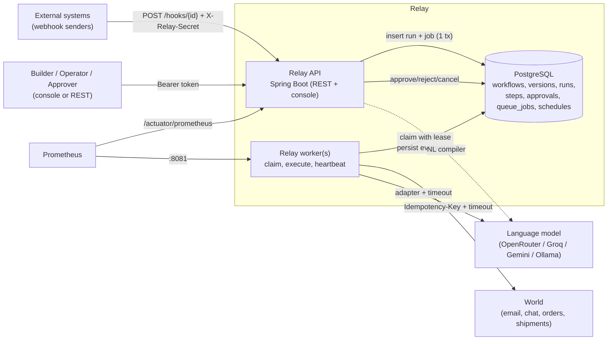
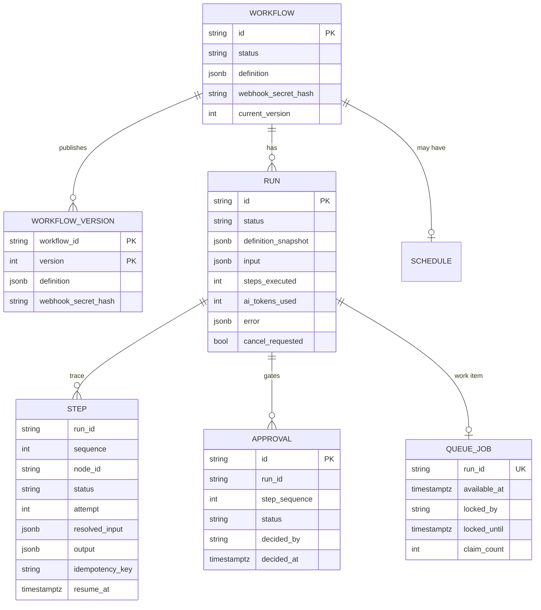
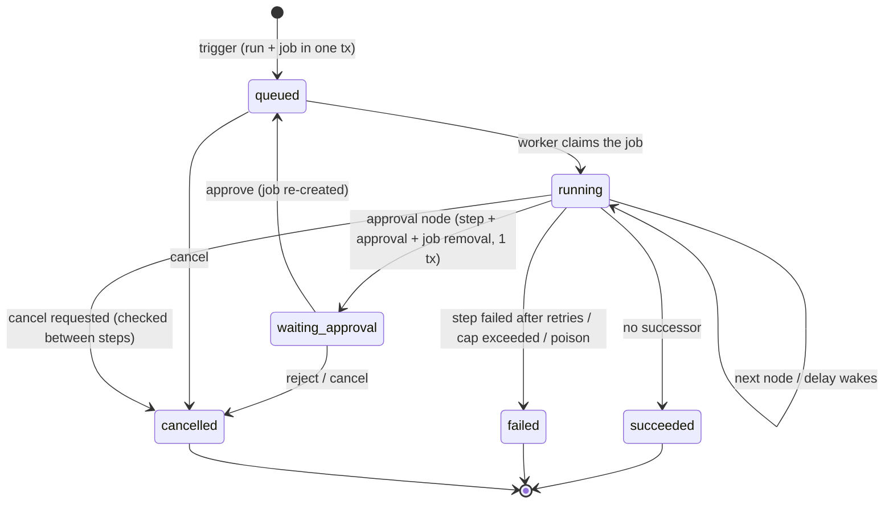
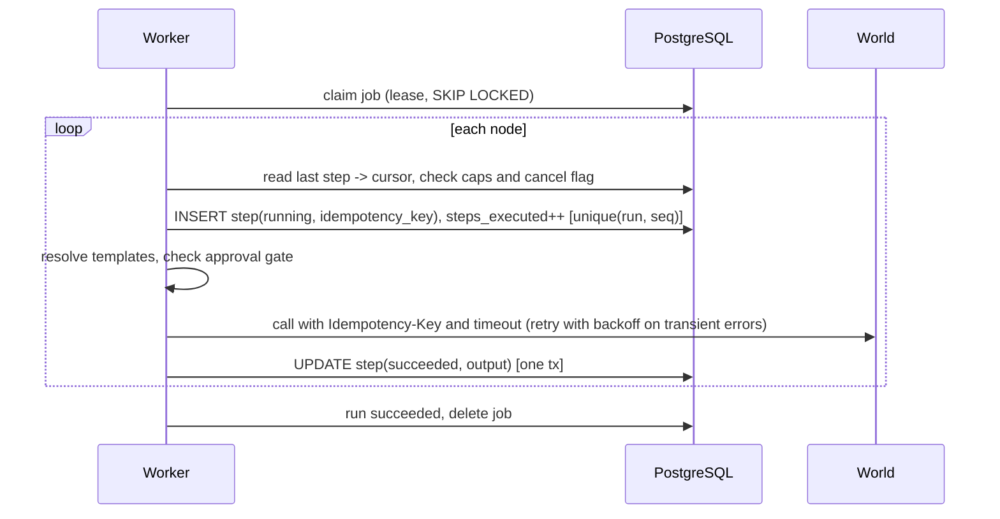

# Relay architecture

Relay is a durable workflow orchestrator whose steps may include machine judgment. This document explains **how it is built and why**.
See also [HLD.md](HLD.md) (system view), [LLD.md](LLD.md) (classes, algorithms, SQL), [PROJECT_STRUCTURE.md](../PROJECT_STRUCTURE.md) (packages and files),
[IMPLEMENTATION_PLAN.md](IMPLEMENTATION_PLAN.md) (how it was built) and [docs/API.md](API.md).

## 1. Principles

1. **State lives in the database, never in memory.** Any process can die at any instant; recovery is derived from persisted rows.
2. **Enforce in the engine, never in the prompt.** Approval gates, the step cap, the time cap and the token cap are database checks and counters in
   the execution loop. Nothing a model outputs can create an approval row or raise a limit.
3. **Untrusted by default.** Webhook payloads and model output are data. They are template values and schema-validated JSON, never code, never
   URLs or recipients that the definition did not already fix.
4. **Exactly-once effects through idempotency, not through hope.** At-least-once execution plus a stable idempotency key per side effect.
5. **Boring, inspectable infrastructure.** One PostgreSQL database is the store, the queue and the audit trail. One artifact runs as API, worker or both.
6. **Extensible at the seams.** New node types, AI providers and triggers are one class (or one catalog entry) each; the engine does not change.

## 2. Context and containers



The API never executes a run. A trigger inserts the run (with its definition snapshot) and one queue job in a single transaction and returns `202`.

## 3. Domain model



* **Workflow** is the editable working copy; **WorkflowVersion** rows are immutable and numbered. `status = draft | published` describes the working copy.
  A run always executes the latest *published version*, so editing never affects what can be triggered until you publish again.
* **Run** copies the version's definition into `definition_snapshot` at trigger time and executes only that. Editing, republishing or even
  deleting later changes nothing about an in-flight or historical run.
* **Step** is the trace and the unit of recovery. One row per node execution; node ids repeat when a run loops, so `UNIQUE (run_id, sequence)` is the key.

### State machines



Every transition is a compare-and-set on the current status (`UPDATE ... WHERE status IN (...)`), so concurrent actors (worker, cancel API, approval API)
cannot produce an impossible state. Step status: `running → succeeded | failed`, `waiting → succeeded | failed` (delay or approval pending).

## 4. Workflow graph model

A workflow is a **directed graph of typed nodes** connected by edges (`next`, or `on_true`/`on_false` on a condition node). Each node performs exactly **one operation**
and the engine executes **one node at a time**: it picks the next ready node, completes that single operation, persists the result, then follows an edge.

* **Validation uses both traversals** (`GraphAnalyzer`):
  * **BFS** from the entry node computes reachability: unreachable nodes are reported at publish, dangling references are rejected.
  * **DFS** classifies edges: an edge to a node on the current DFS stack is a **back-edge** (a loop).
  * A path search over the graph finds sensitive nodes reachable from the entry without passing an `approval` node (warned at publish, refused at runtime).
* **Loops are legal by contract**, not an oversight: the problem statement requires polling and retry patterns (`wf_runaway` is a loop by design) and bounds them
  with `limits.max_steps` at runtime. So the model is a general directed graph with bounded execution. A strict acyclic (DAG) engine with parallel fan-out is listed as Stretch.
  If you want DAG semantics for a workflow, the analysis already tells you: no back-edges in the publish response means it is acyclic.

### Context mapping (data flowing between nodes)

Each run has an implicit context: `trigger.body` (the payload), the latest `output` of every node that has executed (`nodes.<id>.output`), and `run.id`.
Templates map that context into any later node's params (`{{trigger.body.email}}`, `{{nodes.classify.output.category}}`).

* Path lookups only (arrays by index). No expressions, no filters, no arithmetic.
* An unresolvable path **fails the step** with a clear message; it is never rendered as an empty string.
* A string that is exactly one template keeps the referenced JSON type (a number stays a number); embedded in text it renders canonically.
* Resolution is **single pass**: resolved values are never rescanned, so a payload containing `{{nodes.x.output.y}}` cannot inject template expressions.
* Only params the catalog marks `templatable` are resolved; others (for example an AI node's `output_schema`) are copied verbatim.
* The resolved input of every step is persisted, so a wrong branch can be debugged after the fact.

Passing context from one *workflow* to another (sub-workflows) is a Stretch item and is not implemented; the node-to-node mapping above is.

## 5. Durable execution

### 5.1 The queue

`queue_jobs` holds at most one row per run that has work to do. A worker claims with:

```sql
UPDATE queue_jobs SET locked_by = :worker, locked_until = now() + :lease, claim_count = claim_count + 1
WHERE id = (SELECT id FROM queue_jobs
            WHERE available_at <= now() AND (locked_until IS NULL OR locked_until < now())
            ORDER BY available_at, id FOR UPDATE SKIP LOCKED LIMIT 1)
RETURNING id, run_id, claim_count
```

`SKIP LOCKED` lets any number of workers poll without blocking each other. The **lease** (`locked_until`) is renewed by a heartbeat; if a worker dies the heartbeat
stops, the lease expires, and the job becomes claimable again. A restarted worker with the same `relay.worker.id` releases its predecessor's leases at once.
All time comparisons use the database clock. `claim_count` resets whenever a job is rescheduled (delay), so only genuine crash loops trip the **poison guard**
(`relay.worker.max-claims`), which fails the run as `max_claims_exceeded` instead of looping forever.

### 5.2 The execution loop (`RunExecutor`)

The cursor is derived **only from the last persisted step**; nothing is remembered between iterations:

| Last step is | Meaning | Action |
|---|---|---|
| none | fresh run | start at `entry` |
| `succeeded` | node done | follow its edge (`on_true`/`on_false` from `output.result`, else `next`); no edge → run `succeeded` |
| `running` | the process died while executing this node | **re-execute that same step**, same sequence, same idempotency key |
| `waiting` (delay) | sleeping | wake time not reached: reschedule the job; reached: complete the step and continue |
| `waiting` (approval) | pending human | nothing to do; the approve API re-queues |
| `failed` | defensive | fail the run |

Per node: (1) caps are checked, (2) a step row is inserted as `running` **before** executing, together with the `steps_executed` increment, (3) templates are resolved and the
resolved input persisted, (4) the approval gate is checked for sensitive nodes, (5) the executor runs with retries and backoff, (6) the step is completed in one transaction.
Persistence failures are deliberately *not* treated as node failures: they propagate, the lease expires, and the run resumes.



### 5.3 Exactly-once recovery and the crash window

Execution is **at-least-once**; effects are **exactly-once** because the idempotency key is stable. The key is `{run_id}:{node_id}` (plus `:{visit}` for the 2nd and later
visit of a node in a loop, since loop iterations are distinct effects while retries of one iteration are not). It never contains the attempt number, and it is stored on the
step row when the step is created, so retries and resumes read the *same* key back.

| Where the process dies | Persisted state | On resume | Ledger |
|---|---|---|---|
| before the step row exists | previous step `succeeded` | step is created and executed | executed once |
| after the row, before the call | step `running` | re-executed, same key | executed once |
| **after the call landed, before the step was completed** (the crash window) | step `running`, effect already at the world | re-executed, same key; the world replays the stored response | executed once, **one replay absorbed** |
| after the step completed | step `succeeded` | skipped, never re-executed | executed once |

This is verified live (`scripts/run_drills.py`, drill 3) and in `DurabilityIT.theCrashWindowIsClosedByTheStableIdempotencyKey`.
A zombie worker that lost its lease cannot corrupt anything: it notices on its next lease check, and `UNIQUE (run_id, sequence)` rejects a duplicate step insert.

### 5.4 Delays, approvals, cancellation

* **Delay**: the wake-up time is persisted (`steps.resume_at`) and the job is rescheduled for it in the same transaction. Nothing sleeps in memory, so a delay costs no worker thread and survives any restart.
* **Approval**: step, approval row, run status change and job deletion happen in one transaction. Approve completes the step and re-queues the run; reject ends the run `cancelled`.
* **Cancel**: `queued` and `waiting_approval` runs are cancelled immediately (the pending approval is closed). A `running` run is cancelled cooperatively between steps; a run sleeping in a delay is woken so it can notice.
* **Retries**: transient failures (timeouts, connection errors, HTTP 408/429/5xx) retry with exponential backoff and jitter; permanent failures (other 4xx, bad templates, schema violations) fail immediately.

## 6. AI nodes

`AiProvider` is the only seam to a model. `OpenAiCompatibleProvider` speaks `/chat/completions` (OpenRouter, Groq, Gemini's compatibility layer, Ollama, OpenAI);
`HeuristicAiProvider` is a deterministic offline model used by tests, CI and keyless demos. `AiNodeRunner` enforces the contract: **validate the output against the node's JSON Schema; on failure retry once
with the validation errors appended; if it still does not conform, fail the step cleanly.** A schema failure is not retried by the engine (re-asking identically cannot help). Token usage is summed across attempts, recorded on the step and the run, and
every attempt is stored in `steps.ai_attempts`. The system prompt tells the model to treat the quoted input as data, but **safety does not depend on it**: see below.

### Defence in depth against prompt injection

| Layer | What it prevents |
|---|---|
| Output is schema-validated (`additionalProperties: false`) | a model cannot smuggle extra fields such as a recipient |
| Notification targets and refund amounts come only from the workflow definition | AI output cannot redirect messages or choose an amount |
| `order_action` is unreachable without an approved approval row (database check in the engine) | a fooled model cannot skip the human |
| Only the approve API (role `APPROVER`) writes approved rows | no node, template or model output can create one |
| Templates are single-pass, order ids are charset-restricted before entering a URL path | payload text cannot inject templates or path segments |
| `http_request` is restricted to an allow-list of hosts (no redirects) | SSRF, metadata endpoints |
| Secrets and API keys never enter traces, errors or responses | exfiltration through logs and the console |

## 7. Serialization and storage

* **Definitions, snapshots, inputs, outputs, AI attempt logs and errors are stored as JSON in `jsonb` columns.** `JsonCodec` is the single (de)serialization point for repositories.
* On the way out, JSON is **deserialized into typed views** (`WorkflowDefinition`, node records) used by the engine; the JSON document stays the source of truth.
  Definitions are validated before they can be published; snapshots are therefore always valid typed graphs.
* **Immutable history** for what runs: `workflow_versions` rows and the per-run `definition_snapshot` are never updated.
* **Secrets** are stored only as SHA-256 hashes; the stored definition carries a `[REDACTED]` marker. API responses are built from these records, so a secret cannot be echoed.
* The database schema itself is versioned with Flyway migrations (`V1__init_schema.sql`).
* JSON in the API is snake_case; the node and trigger registry (`data/node_catalog.json`) is the schema boundary for every definition.

## 8. Security model

Deny-by-default Spring Security with stateless bearer tokens and three roles (builder, operator, approver). The webhook route is public and guarded by a per-workflow secret
(constant-time compare of hashes). Tokens are compared in constant time. The prod profile refuses to start with the default token. Containers run as a non-root user. Error bodies never include stack traces or SQL.
The console renders all untrusted text with `textContent`, so hostile payloads cannot inject markup. Known gaps are listed in the README.

## 9. Observability

Structured log lines carry `[run=<id>] [step=<node>]` (MDC). Micrometer exposes run outcomes, step outcomes and latency, retries, resumes after interruption, AI token counts, queue depth and pending approvals
at `/actuator/prometheus`. Liveness and readiness probes are enabled. The step trace *is* the audit trail: resolved input, output, attempts, timings, tokens, idempotency key and the decider of every approval.

## 10. Extending Relay

| To add | Do |
|---|---|
| a node type | add its entry to `data/node_catalog.json` (params, `side_effect`, `requires_approval`) and one `NodeExecutor` bean with that `type()`. Validation, templating, retries, tracing and gating apply automatically. |
| an AI provider | implement `AiProvider` and select it in `AiProviderConfig` |
| a trigger | add it to the catalog's `triggers`; start runs through `RunService` (the schedule dispatcher is the model) |
| a role or auth scheme | extend `PrincipalRegistry` / `SecurityConfig` |

## 11. Scalability and failure modes

* Throughput scales with worker count and `relay.worker.concurrency`; the queue is a single indexed table claimed with `SKIP LOCKED`. Delays and approvals hold no thread.
* The database is the shared dependency: it must be highly available (RDS Multi-AZ) and sized for step row volume (archive old runs).
* Downstream outages degrade to retries, then a failed run that can be **replayed** from its failed step. A model outage fails AI steps after retries; runs without AI nodes are unaffected.
* A thundering herd of webhooks only grows the queue; the API's work per request is one insert.

## 12. Decision log

| # | Decision | Why | Trade-off |
|---|---|---|---|
| 1 | PostgreSQL is store, queue and audit trail | one consistent transactional system; `SKIP LOCKED` is a proven queue; no extra infrastructure | polling latency (default 500 ms) and queue throughput bounded by one database; a broker would be the next step at very high volume |
| 2 | Lease + heartbeat + same-id release instead of a lock table | crash recovery without operator action; immediate takeover on restart | requires unique worker ids per live process (documented) |
| 3 | Insert the step row as `running` before executing | the cursor survives a crash; stable sequence and key; trace shows in-flight work | one extra write per step |
| 4 | Idempotency key `{run}:{node}[:visit]`, stored on the step | closes the crash window; loops stay distinct | requires an idempotent downstream (the world's contract) |
| 5 | Delay by rescheduling, not sleeping | frees threads, survives restarts, trivial to cancel | wake-up granularity equals poll interval |
| 6 | Approval gate is a DB query in the engine | cannot be influenced by any model or template | an approved row anywhere earlier in the run satisfies the gate (documented; a stricter per-node pairing is future work) |
| 7 | Directed graph with legal loops, not a strict DAG | the contract requires polling loops; `max_steps` bounds them | no parallel fan-out (Stretch) |
| 8 | `JdbcClient` (SQL) instead of JPA | explicit control of `SKIP LOCKED`, CAS updates, jsonb, and transaction boundaries on the hot path | more SQL to maintain |
| 9 | Secrets stored as hashes, definitions redacted | a database dump or API response never reveals a webhook secret | a secret cannot be recovered, only rotated |
| 10 | `timeout_seconds` excludes approval wait | a human taking an hour must not fail the run on resume | the cap measures active time only |
| 11 | Heuristic offline AI provider | deterministic tests, keyless CI and demos; never copies untrusted text into outputs | not a real model; the NL compiler refuses to run on it rather than guess |
| 12 | One artifact, three modes (`api`, `worker`, both) | simple to build and operate; same code path in dev and prod | the worker still starts a small web server for probes |
| 13 | Timeouts on every external call; no HTTP redirects for `http_request` | a hung dependency fails a step, never the engine; redirects cannot bypass the allow-list | none significant |

## 13. How this answers the architecture review

| Review point | Where |
|---|---|
| DAG: nodes connected | §4: typed nodes + directed edges; `WorkflowDefinition`, `GraphAnalyzer` |
| DFS / BFS | §4: BFS reachability, DFS back-edge (loop) classification, approval-path search |
| In the background, pick one operation and complete it with one graph node | §5.2: the worker claims a run, executes **one node = one operation**, persists, then follows the edge |
| Context mapping between nodes | §4: the run context and `{{...}}` mapping (workflow-to-workflow is Stretch) |
| HLD | [HLD.md](HLD.md) and §2 |
| Serialization / deserialization with respect to storage | §7 |
