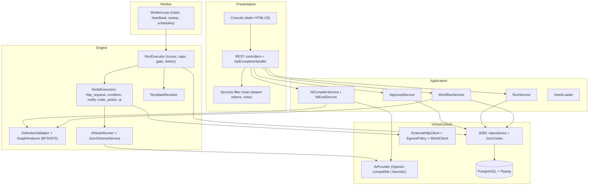
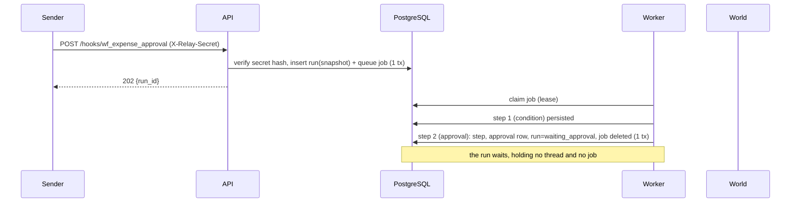
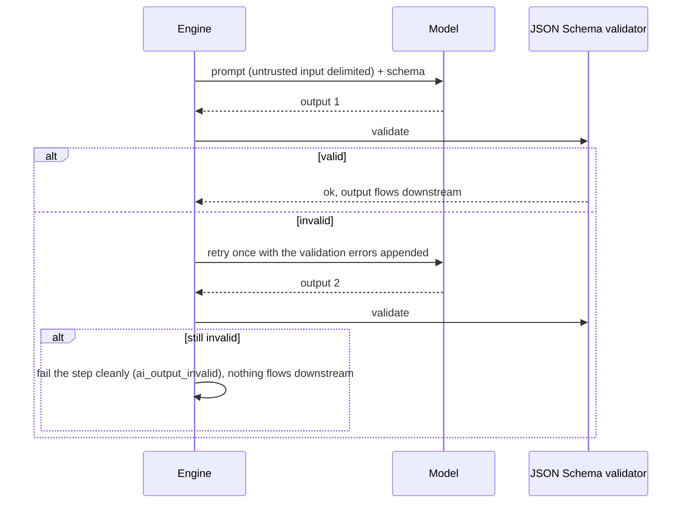
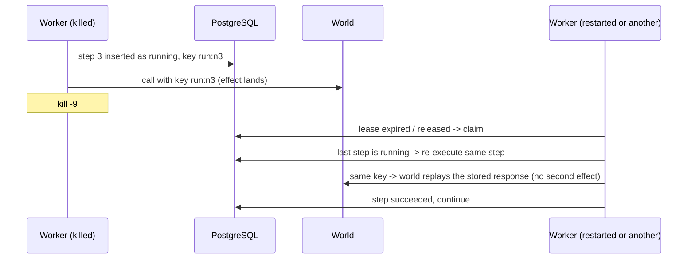
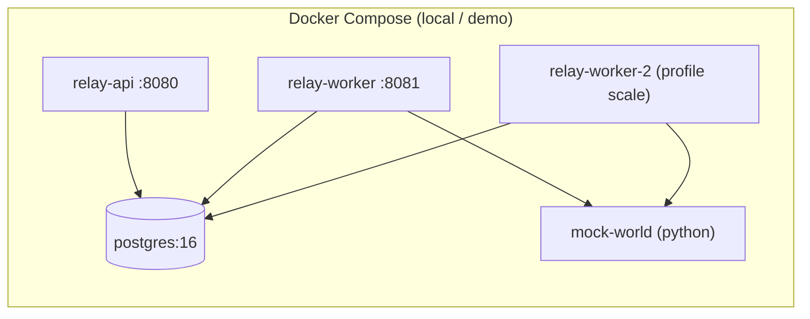

# Relay: High-Level Design

## 1. Purpose and scope

Operations teams run on workflows: a webhook arrives, a check is made, a message is classified, a manager approves, an action is taken. Relay is the platform that
defines, triggers and **reliably executes** such workflows, including steps where a language model makes a decision. Reliability means: runs survive crashes, side
effects never fire twice, model output is structurally valid before anything trusts it, sensitive actions cannot happen without a human, and every run is fully traceable.

In scope: workflow definitions with a draft/publish lifecycle, webhook/manual/schedule triggers, durable asynchronous execution, deterministic and AI nodes,
approval gates, retries, caps, traces, a read-and-operate console, and a natural-language compiler. Out of scope (Stretch): parallel branches, sub-workflows,
agent nodes, cost accounting, multi-tenancy, real connectors.

### Actors

| Actor | Does | Interface |
|---|---|---|
| Builder | writes, validates, publishes workflows; compiles from English | REST, console |
| Operator | triggers, watches, cancels, replays runs; reads traces | console, REST |
| Approver | approves or rejects pending actions | console, REST |
| External system | POSTs events to a workflow's webhook with its secret | `POST /hooks/{id}` |
| Scheduler | fires cron triggers | internal (worker) |

## 2. Capability map

| Capability | Component | Requirement it answers |
|---|---|---|
| Typed-node workflow definitions, draft → publish, versions, per-run snapshot | `WorkflowService`, `DefinitionValidator`, `workflows`/`workflow_versions`/`runs` | Must Have 2 |
| Webhook (secret) and manual triggers; cron schedules | `HookController`, `RunService`, `ScheduleDispatcher` | Must Have 3 |
| Deterministic nodes with template data flow | `NodeExecutor` beans, `TemplateResolver` | Must Have 4 |
| AI nodes with enforced structure and token accounting | `AiNodeRunner`, `AiProvider` | Must Have 5 |
| Durable execution: queue, worker, per-step persistence, crash resume, exactly-once effects | `QueueRepository`, `WorkerLoop`, `RunExecutor` | Must Have 6 |
| Approvals, retries with backoff, step cap, status vocabulary | `ApprovalService`, `RunExecutor`, `RetryPolicy` | Must Have 7 |
| Traces, console, smoke test, duplication check, automated tests | `RunController`, `static/` console, `scripts/`, `src/test` | Must Have 8 |
| NL compiler with eval | `NlCompilerService`, `NlEvalService` | Good To Have |
| Extra caps, versions, replay, schedules | `RunExecutor`, `WorkflowService`, `RunService`, `ScheduleDispatcher` | Good To Have |
| Multiple workers with leases | `QueueRepository` (leases, SKIP LOCKED), `WorkerLoop` | Stretch |

## 3. Logical architecture



Layering rules: controllers call services; services and the engine call repositories; the engine reaches the outside world only through `NodeExecutor`s, which only
use `WorldClient`/`ExternalHttpClient`/`AiProvider`. Nothing above the repositories knows SQL.

## 4. Key flows

### 4.1 Webhook to completion



### 4.2 Approval and resume

```mermaid
sequenceDiagram
    participant H as Approver
    participant API as API
    participant DB as PostgreSQL
    participant W as Worker
    participant X as World
    H->>API: POST /approvals/{id}/approve (role APPROVER)
    API->>DB: approval=approved (CAS), step waiting->succeeded, run waiting->queued, enqueue (1 tx)
    API-->>H: 200
    W->>DB: claim, cursor = next node
    W->>DB: approval gate: exists approved row for this run?
    W->>X: refund with Idempotency-Key run:node
    W->>DB: step succeeded; run succeeded
```

### 4.3 AI node with schema enforcement



### 4.4 Crash and recovery



### 4.5 Natural-language compile

Description (data) → prompt with the catalog and rules → model → candidate JSON → `DefinitionValidator` + gate analysis → on problems, repair loop (max 2) with the validator's own error messages →
persisted Draft, or a refusal that names the missing capabilities. The model can never widen what the platform accepts.

## 5. Deployment view



Production reference (see [docs/DEPLOYMENT.md](DEPLOYMENT.md)): ALB → ECS Fargate `relay-api` (2+) and `relay-worker` (2+) → RDS PostgreSQL Multi-AZ; secrets from Secrets Manager;
Prometheus scrapes both services; scale workers on `relay_queue_ready`.

## 6. Data view (summary)

`workflows` (working copy) · `workflow_versions` (immutable) · `runs` (status, snapshot, input, counters, error) · `steps` (the trace) · `approvals` · `queue_jobs` (work items with leases) · `schedules`.
Full DDL and indexes in [LLD.md](LLD.md#4-database).

## 7. Non-functional requirements

| Attribute | Target and how it is met |
|---|---|
| Durability | no acknowledged run or step is lost on process or node failure: state is committed to PostgreSQL before any acknowledgement |
| Correctness | exactly-once effects per ledger under crash and retry; verified by drills and integration tests |
| Safety | sensitive actions impossible without an approval row; injection cannot widen targets, amounts or privileges |
| Availability | stateless API and workers; any can die; leases expire; the database is the only stateful dependency (Multi-AZ) |
| Latency | trigger returns after one transaction (`202`); execution starts within one poll interval (default 500 ms) |
| Scalability | horizontal in workers (`SKIP LOCKED`); delays and approvals consume no threads |
| Security | deny-by-default, role separation, hashed secrets, SSRF allow-list, no secrets in traces/responses, non-root container |
| Observability | MDC-tagged logs, Prometheus metrics, health probes, full step trace as audit trail |
| Maintainability | layered packages, one class per node type, SQL isolated in repositories, Flyway migrations, 140+ automated tests |
| Portability | one jar / one image; any OpenAI-compatible model; any PostgreSQL 14+ |

## 8. Risks and mitigations

| Risk | Mitigation |
|---|---|
| Downstream not idempotent | contract requires `Idempotency-Key` support; keys are stable; ledger audit (`duplication_check.py`) |
| Database becomes the bottleneck | indexes on queue/steps, archival of finished runs, broker as a documented next step |
| Model outage or cost | adapter seam, retries with backoff, offline provider, per-run `max_ai_tokens` |
| Prompt injection | defence in depth (see ARCHITECTURE §6); gate and targets are not model-controlled |
| Poison run crashing workers | claim counter quarantine (`max_claims_exceeded`) |
| Runaway loops | `max_steps`, `timeout_seconds`, both enforced by the engine |
| Secret leakage | hashes at rest, redaction in views, header redaction in traces, constant-time compare |
