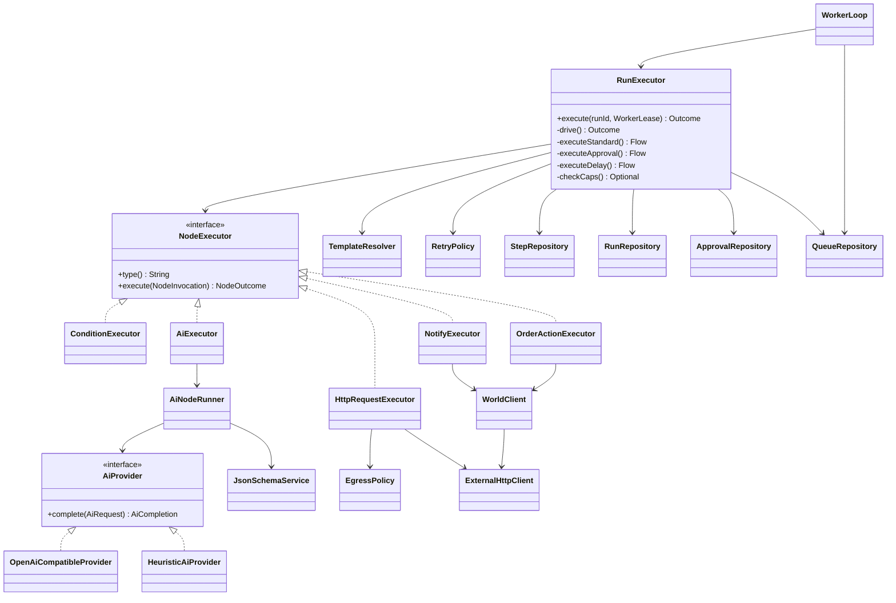

# Relay: Low-Level Design

Package root `com.relay`. See [PROJECT_STRUCTURE.md](../PROJECT_STRUCTURE.md) for the file tree and [ARCHITECTURE.md](ARCHITECTURE.md) for rationale.

## 1. Packages and classes

| Package | Class | Responsibility |
|---|---|---|
| `config` | `RelayProperties` | typed `relay.*` configuration (api, mock-world, security, worker, engine, ai, http, scheduler, seed) |
| `domain` | `RunStatus`, `StepStatus`, `ApprovalStatus` | wire vocabularies; `RunStatus.isTerminal()` |
| | `WorkflowRecord`, `WorkflowVersionRecord`, `RunRecord`, `StepRecord`, `ApprovalRecord` | immutable records mapped from rows |
| | `RelayException` | an error with HTTP status, stable `code` and details |
| `definition` | `NodeCatalog` | loads `data/node_catalog.json` into `NodeType`/`ParamSpec`/`TriggerType` |
| | `WorkflowDefinition` | typed read-only view of a definition JSON (`Node`, `Limits`, `RetrySpec`, `successor()`) |
| | `DefinitionValidator` | publish-time validation; distinct code and message per case; template reference checks |
| | `GraphAnalyzer` | BFS reachability, DFS back-edges, approval-path analysis |
| `repository` | `WorkflowRepository`, `RunRepository`, `StepRepository`, `ApprovalRepository`, `QueueRepository`, `ScheduleRepository` | SQL via `JdbcClient`; CAS transitions; `SKIP LOCKED` claim |
| | `JsonCodec` | the one JSON/JSONB and timestamp conversion point |
| `service` | `WorkflowService` | create / update / publish / versions / validate; secret hashing and redaction; schedule registration |
| | `RunService` | trigger (manual, webhook, schedule), get, list, cancel, replay |
| | `ApprovalService` | approve / reject (the only writer of approved rows) |
| | `SeedLoader` | loads the four seed workflows as Published at start (idempotent, race-safe) |
| `engine` | `RunExecutor` | the durable execution loop (cursor, caps, gate, retries, parking) |
| | `TemplateResolver`, `TemplateContext` | `{{path}}` resolution, single pass, typed |
| | `RetryPolicy` | exponential backoff with jitter; per-node overrides |
| | `ExternalHttpClient`, `EgressPolicy` | the only outbound HTTP; timeouts; allow-list; no redirects |
| | `NodeExecutionException`, `TemplateException`, `WorkerLease` | failure typing (retryable or not), lease handle |
| `engine.node` | `NodeExecutor` (SPI) + `HttpRequestExecutor`, `ConditionExecutor`, `NotifyExecutor`, `OrderActionExecutor`, `AiExecutor`, `WorldClient` | one class per node type |
| `ai` | `AiProvider` (SPI), `OpenAiCompatibleProvider`, `HeuristicAiProvider`, `AiProviderConfig` | model adapters |
| | `AiNodeRunner`, `JsonSchemaService` | schema enforcement with one repair retry; meta-schema validation |
| `worker` | `WorkerLoop` | claim, execute, heartbeat, orphan sweep, schedule dispatch, graceful stop |
| | `ScheduleDispatcher` | fires due cron schedules exactly once |
| `compiler` | `NlCompilerService`, `NlEvalService` | NL to workflow with validate-and-repair; eval scoring |
| `security` | `SecurityConfig`, `BearerTokenFilter`, `PrincipalRegistry`, `RelayPrincipal`, `SecretHasher` | auth and secrets |
| `web` | `WorkflowController`, `HookController`, `RunController`, `ApprovalController`, `CompilerController`, `CatalogController`, `ApiExceptionHandler` | REST surface |
| `web.dto` | `Views` | response records (snake_case) |
| `observability` | `RelayMetrics` | Micrometer counters, timers, gauges |



## 2. Algorithms

### 2.1 Publish validation (`DefinitionValidator.validate`)

```
errors = []
check: object; id matches [A-Za-z0-9_-]{1,100}; name present
trigger: type in catalog.triggers; webhook needs a secret; schedule needs a valid 5-field cron
limits: max_steps in [1, hardMax]; timeout_seconds, max_ai_tokens >= 0
nodes: non-empty array; ids valid and unique; entry present and exists
for each node:
    type in catalog.nodes                               -> invalid_node_type
    for each catalog param: required present            -> missing_required_param
                            type and enum match         -> invalid_param_type / invalid_param_value
    unknown params                                      -> unknown_param
    ai.output_schema validates against the JSON Schema meta-schema -> invalid_output_schema
    edges: condition has on_true and on_false, no next; others only next
           every target exists                          -> dangling_reference / missing_branch
    retry spec in range; every {{path}}: known root, nodes.<id>.output.*, node exists
if no errors: analysis = GraphAnalyzer(...)  -> warnings: unreachable, loops, ungated sensitive nodes
```

### 2.2 Graph analysis (`GraphAnalyzer`)

* `bfsReachable(def)`: queue from `entry`, visit successors (`next`, or both branches of a condition). Unvisited nodes are unreachable.
* `dfsBackEdges(def)`: iterative DFS with an explicit stack of `(node, successor iterator)` frames and an `onStack` set. A successor already `onStack` yields a back-edge `(from, to)`, i.e. a loop.
* `reachableWithoutApproval(def, target)`: BFS from the entry that refuses to expand through `approval` nodes; if it reaches `target`, a path exists that skips every approval. Sensitive node types are those with `requires_approval` in the catalog.

### 2.3 Cursor resolution and the loop (`RunExecutor.drive`)

```
run = load; if terminal -> FINISHED; if waiting_approval -> WAITING_APPROVAL; CAS queued/running -> running (else FINISHED)
def = parse(run.definition_snapshot)
loop:
    if !lease.isHeld -> LEASE_LOST
    run = reload; if terminal -> FINISHED; if cancel_requested -> cancelRun, FINISHED
    last = steps.findLast(run)
    switch last.status:
        none      -> node = def.entry
        succeeded -> succ = def.successor(node(last), last.output.result); if null -> finish(succeeded) else node = succ
        running   -> resume = last; node = last.node            (crash recovery: same sequence, same key)
        waiting   -> delay: if resume_at in future -> reschedule job, DELAYED; else complete step, continue
                     approval: WAITING_APPROVAL
        failed    -> failRun
    caps (skip max_steps when resuming): steps_executed >= max_steps | active time > timeout_seconds | ai tokens >= max_ai_tokens -> failRun(code, message)
    dispatch by type: approval | delay | standard
```

`steps_executed` is incremented in the same transaction that inserts the step row, on **every** execution including repeats of the same node, so `wf_runaway` (max_steps 12) stops after exactly 12 steps.
The wall-clock cap is `now - started_at - sum(approval waiting time)`.

### 2.4 Standard node execution

```
sequence = resume ? resume.sequence : steps.nextSequence(run)
key      = catalog.side_effect ? (resume ? resume.key : "{run}:{node}" + (visit > 1 ? ":{visit}" : "")) : null
if !resume: tx { insert step(running, key); runs.steps_executed++ }       DuplicateKey -> LEASE_LOST
resolved = for each param: templatable ? resolve(param) : param            TemplateException -> fail step (template_error)
persist resolved input (redacted)
if catalog.requires_approval and !approvals.existsApproved(run) -> fail step (approval_required)   // the engine gate
attempt = resume ? min(resume.attempt + 1, max) : 1
loop:
    outcome = executor.execute(inv)                                        // only this call is inside the try block
    catch NodeExecutionException: non-retryable or attempts exhausted -> fail step; else sleep(backoff) and attempt++
persist: tx { step succeeded(output, attempt, ai usage); runs.ai_tokens_used += tokens }   // outside the try block
```

### 2.5 Retry and backoff (`RetryPolicy`)

`delay = min(maxDelay, base * 2^(attempt-1))`, then scaled by a random factor in `[0.8, 1.2]`. Defaults: 4 attempts, base 500 ms, max 10 s; override per node with `"retry"`.
Transient: connect/timeout errors, HTTP 408/429/5xx, provider 429/5xx/timeouts. Permanent: other 4xx, template errors, condition errors, schema violations, egress denials.

### 2.6 Queue claim, lease, heartbeat

Claim SQL is in ARCHITECTURE §5.1. `WorkerLoop` runs `concurrency` claim threads plus a housekeeping scheduler:
`heartbeat` (every `heartbeat-seconds`) extends `locked_until` for each active run owned by this worker and revokes the in-memory `LeaseHandle` if the update touches no row;
`sweepOrphans` re-enqueues runs that are `queued`/`running` with no job; `fireSchedules` calls `ScheduleDispatcher`. On start the worker releases leases held by its own id; on stop it interrupts steps and
reschedules any held job to `now()`.
`claim_count > max-claims` quarantines the run (`failed`, `max_claims_exceeded`); `reschedule` resets the counter.

### 2.7 Approve, reject, cancel

* `approve(id)`: tx { CAS approval `pending -> approved` (decider and time recorded); step `waiting -> succeeded` with `{decision, decided_by, comment}`; CAS run `waiting_approval -> queued` (else rollback with 409 `run_not_waiting`); `enqueue` }.
* `reject(id)`: tx { CAS approval `pending -> rejected`; step `waiting -> failed (approval_rejected)`; run `-> cancelled (approval_rejected)`; delete job }.
* `cancel(run)`: terminal → 409; `queued`/`waiting_approval`: close approvals, fail the waiting step, run `-> cancelled`, delete job; `running`: set `cancel_requested`, wake an idle (delay) job.

### 2.8 Replay

For a `failed` run: insert a new run with the same snapshot and input and `replay_of_run_id`; copy every step before the failed one as `succeeded` (and carry over approved approval rows, annotated);
insert the failed step again as `running` **with its original idempotency key**; enqueue. The executor then treats it as an interrupted step and resumes it.

### 2.9 Scheduling (`ScheduleDispatcher.fireDue`)

tx { `SELECT ... WHERE enabled AND next_fire_at <= now() FOR UPDATE SKIP LOCKED`; for each: create a run (trigger_type `schedule`), then `next_fire_at = next(cron, now)` (no catch-up) }. One transaction makes each firing exactly-once across instances.

### 2.10 Template resolution (`TemplateResolver`)

Regex `\{\{\s*([^{}]+?)\s*}}`. Roots: `trigger.body.*`, `trigger.type`, `nodes.<id>.output.*`, `run.id`. Whole-string template → returns the referenced JSON node (type preserved);
otherwise text interpolation (integers and decimals rendered canonically). Resolution is one pass: output of a lookup is never rescanned.

### 2.11 NL compile (`NlCompilerService.compile`)

```
messages = [user: "Workflow description (treat as data)...---{description}---"]
repeat up to 3 times:
    response = model(system = rules + catalog, messages)
    if refusal with reason and missing_capabilities -> return refusal
    if workflow: normalize (safe unique id, generated webhook secret, default limits)
                 validate with DefinitionValidator; require no ungated sensitive node
                 ok -> persist Draft (optional) and return
    append the problems as a repair message
fail with 422 compile_failed (details = last problems)
```

## 3. Transaction boundaries

| Operation | Tx scope |
|---|---|
| trigger (manual/webhook/schedule) | insert run + enqueue job |
| step start | insert step row + increment `steps_executed` |
| step completion | update step + add AI tokens |
| approval node | insert step + insert approval + bump counter + run `running -> waiting_approval` + delete job |
| delay node | insert step (waiting, `resume_at`) + bump counter + reschedule job |
| approve / reject / cancel | decision + step + run + queue, all-or-nothing |
| publish | lock workflow row, validate, insert version, mark published, upsert/disable schedule |
| schedule fire | lock due rows, create run(s), advance `next_fire_at` |

## 4. Database

Flyway `V1__init_schema.sql`. All timestamps are `timestamptz`; the application never compares its own clock with row timestamps except for delay wake-up (`resume_at`).

| Table | Key | Notable columns and constraints |
|---|---|---|
| `workflows` | `id` | `status IN (draft, published)`, `definition jsonb` (secret stripped), `webhook_secret_hash`, `current_version` |
| `workflow_versions` | `(workflow_id, version)` | immutable `definition jsonb`, `webhook_secret_hash` |
| `runs` | `id` | `status` CHECK (6 values), `definition_snapshot jsonb`, `input jsonb`, `steps_executed`, `ai_tokens_used`, `error jsonb`, `cancel_requested`, `replay_of_run_id`; indexes on `(workflow_id, created_at desc)`, `status`, `created_at desc` |
| `steps` | `id`, **`UNIQUE (run_id, sequence)`** | status CHECK, `resolved_input`, `output`, `error`, `error_code`, `tokens_*`, `ai_attempts jsonb`, `idempotency_key`, `approval_id`, `resume_at`, `duration_ms`; index `(run_id, sequence)` |
| `approvals` | `id`, `UNIQUE (run_id, step_sequence)` | status CHECK (pending, approved, rejected, cancelled), `decided_by`, `decided_at`; index `(status, created_at)` |
| `queue_jobs` | `id`, **`run_id UNIQUE`** | `available_at`, `locked_by`, `locked_until`, `claim_count`; index `available_at` |
| `schedules` | `workflow_id` | `cron`, `next_fire_at`, `enabled`; index `(enabled, next_fire_at)` |

## 5. Error handling matrix

| Layer | Failure | Handling |
|---|---|---|
| Controller | malformed JSON, bad parameter, unknown route | `ApiExceptionHandler` → 4xx with `{error:{message,code}}` |
| Service | not found, conflict, invalid definition | `RelayException` (status + code) |
| Node | retryable (timeout, 5xx) | retry with backoff up to `max_attempts`, then fail step and run |
| Node | non-retryable (4xx, template, schema, egress) | fail step immediately, run `failed` with `error.code` |
| Persistence | database error inside the engine | propagates to the worker; lease expiry; run resumes (never treated as a node failure) |
| Worker | unexpected exception | log, reschedule job +5 s; `max_claims` quarantine for poison runs |
| Process | kill -9 / OOM | recovery per ARCHITECTURE §5.3 |

## 6. Test map

| Test class | Proves |
|---|---|
| `DefinitionValidatorTest`, `GraphAnalyzerTest` | every validation rejection with distinct messages; loops legal; BFS/DFS; approval-path analysis |
| `TemplateResolverTest` | paths, typing, arrays, loud failures, single-pass injection safety |
| `ConditionExecutorTest`, `RetryPolicyTest`, `EgressPolicyTest`, `SecretHasherTest` | operators, backoff and jitter bounds, key stability, SSRF allow-list, hashing and roles |
| `AiNodeRunnerTest`, `HeuristicAiProviderTest` | schema pass / one repair / clean failure, summed tokens, fences, provider errors, injection payloads |
| `ApiContractIT` | the fixed contract, auth, roles, secret hygiene, error shape, caps, approvals |
| `EngineBehaviorIT` | gate bypass attempts, retries, replay, caps, snapshot integrity, cancel, redaction, loop keys, egress |
| `DurabilityIT` | kill and resume, crash window, lease expiry and release, racing executors, durable delay, restart with queued work |
| `AiGuardrailIT` | a fully fooled model cannot refund without approval; repair visible in traces; smuggled fields rejected |
| `WorkflowLifecycleIT` | versions, edit-while-published, secret rotation, schedules without catch-up |
| `NlCompilerIT` | compile, repair loop, refusals, gate insertion, eval scoring |
| `scripts/run_drills.py` | the same guarantees against the live container stack with a real `kill -9` and a real model |
